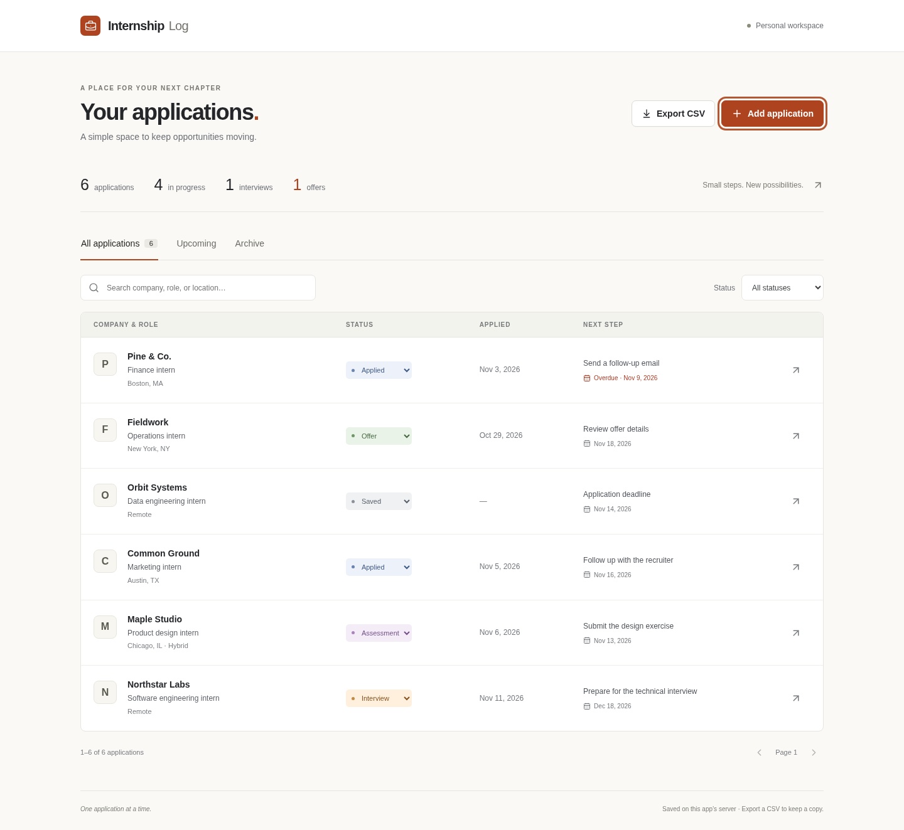

# Internship Log

A simple personal internship tracker. Save opportunities, update application stages, record interview notes, and see the next thing to do. A quiet, light interface with a full-width application list and a single terracotta accent.

- Track Saved → Applied → Assessment → Interview → Offer, plus Rejected and Withdrawn.
- Keep company, role, location, posting link, applied date, deadline, next action, and notes together.
- See upcoming actions and deadlines, with overdue dates clearly marked.
- Search, filter, archive, restore, and export your current view to CSV.
- Keep an automatic history of stage changes. Conflicting edits from another tab are rejected so they cannot silently overwrite your notes.

Everything is entered manually. There are no AI providers, API keys, accounts, scraping, or background message queues.



_Fictional applications shown for illustration. Your tracker starts empty._

## Run on your computer

Install **Node.js 24 LTS** from [nodejs.org](https://nodejs.org/). Node 18 is too old for the build tools; the minimum supported version is 22.12. If you use nvm, run `nvm install` and `nvm use` in this folder.

Download and extract the project, open a terminal in the extracted folder, and run:

```bash
npm ci
npm run build
npm start
```

Open **http://localhost:3000**. Leave that terminal running. Press Ctrl+C to stop.

The app starts empty. Click **Add application** to enter your first opportunity. Records persist in `.internship-data/` inside this folder, including after restarting. No Docker or `.env` file is needed for this mode. `npm run demo` and `npm run dev` are aliases for the same local app; they also save your data.

If port 3000 is occupied:

```bash
npm start -- --port 3001
```

Then open http://localhost:3001. A different project directory or `DATA_DIR` uses a different database. Never run two local processes against the same data directory simultaneously.

## Using the tracker

Click a company or its arrow to edit an application. Change a stage directly in the list, or in the edit form. Selecting Applied fills an empty applied date with today's local date; you can edit it.

**Upcoming** shows next actions with dates and application deadlines for roles still in Saved. Applying closes the application-deadline reminder; next actions remain. Rejected, withdrawn, and archived applications do not appear there. Dates are calendar dates, and reminders are displayed inside the app; it does not send notifications.

To archive, open an application, check **Move to archive**, and save. Uncheck it in the Archive view to restore. Delete is permanent and asks for confirmation.

**Export CSV** downloads every row matching the current view, search, and status filter, including other pages. Export All applications and Archive separately if you want both. CSV is a readable copy; this version has no CSV import. For a restorable local backup, stop the app and copy `.internship-data/` to a safe location.

The server stores your records. This is a single-user app without sign-in, bound to localhost by default. A public source repository does not publish your applications. Keep it local or behind a private authenticated connection.

## Optional: PostgreSQL with Docker

```bash
docker compose up --build -d --wait
```

Open http://localhost:3000. Docker uses its own persistent PostgreSQL volume, separate from the local `.internship-data/` database. Use one mode at a time on that port. The database names in Compose retain earlier internal names so existing installations keep their data. The interface, package, and running app are Internship Log.

For an existing installation, follow [Upgrade](docs/UPGRADE.md). Do not use `docker compose down -v` unless you intend to erase the database volume.

## Development

```bash
npm run typecheck
npm run lint
npm test
npm run build
```

For hot reload, run `npm start` in one terminal and `npm run dev:web` in another, then open http://localhost:5173. Its API proxy targets port 3000. `npm run dev:api` runs the PostgreSQL API instead; run migrations first with `npm run migrate`.

See [Architecture](docs/ARCHITECTURE.md) and [Demo walkthrough](docs/DEMO.md).
